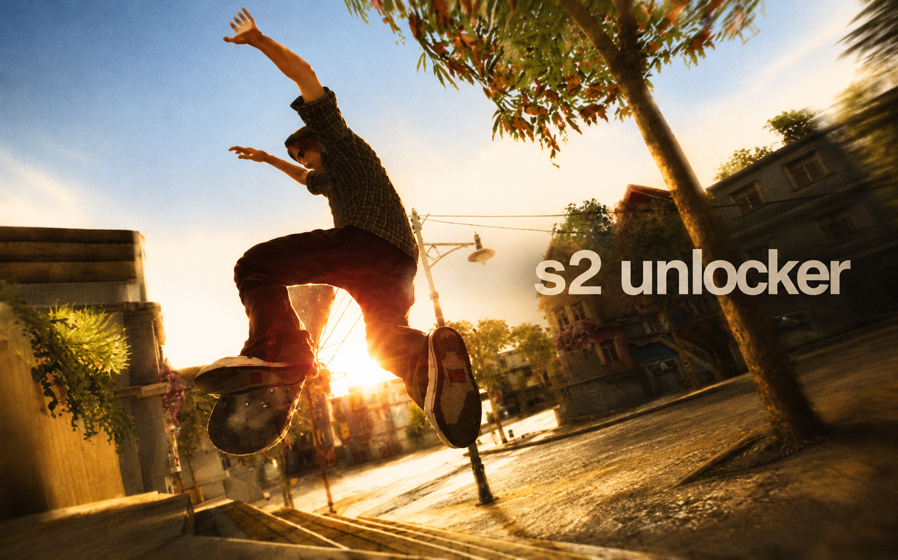

# s2 loader

**Save slots, outfits and unlocks for the Skate 2 PC port.**
A small launcher in the style of the Skate 2 menus: pick a save, pick an outfit, tick what you want, hit **play**.


---

## Features

**Save slots**
- Keep as many copies of your `SKATER.P` as you want: clean career, fully unlocked, test runs, a friend's save.
- Grab the current save from the game folder, import any `SKATER.P` from disk, or drag and drop it onto the window.
- Duplicate, rename, export or delete slots. Deleted slots are kept in backups.
- Each slot shows the skater name, cash and gear progress.

**Outfits (wardrobe)**
- Save the whole skater look (clothes, hair, face, board setup) from any save.
- Wear any saved outfit in any save, either on launch or right away (double-click).
- Attach a screenshot to each outfit.
- Share outfits as `.s2fit` files. Drop one onto the window to import it.

**Tools**
- Set cash to any amount, up to $99,999,999.
- Change the skater name.
- Unlock all gear: sponsor boards, shoes, trucks and wheels, Hall of Meat rewards, pro and branded clothing. DLC packs (First Gear, Throwback) are optional.
- Fix the save checksum.
- Undo the last change.

**Play**
1. The current game save is backed up.
2. The selected slot, with the outfit and options you ticked, is written into the game folder.
3. The game starts and the loader minimizes.
4. When you quit the game, your progress is copied back into the slot.

**Safety**
- Every write makes a backup first. The last 40 are kept by default, adjustable in setup.
- Saves are validated before anything is written.

---

## Requirements

- Windows 10 or 11
- .NET Framework 4.x (ships with Windows)
- The Skate 2 PC port and a save with a started career (for cash and unlocks)

---

## Build

No IDE needed. The C# compiler that ships with Windows is enough.

1. Download or clone the repository.
2. Run `build.bat`.
3. You get a single `s2loader.exe`. The font, backgrounds and icon are embedded in it, so you can move it anywhere.

On first launch a `s2loader_data` folder appears next to the exe:

```
s2loader_data/
├── config.ini      settings
├── saves/          save slots (one folder per slot)
├── outfits/        .s2fit outfits + optional screenshots
└── backups/        automatic backups
```

---

## First run

Open the **setup** tab and set:

- **game exe**: the Skate 2 port executable
- **save folder**: the folder that contains `SKATER.P`. Press **auto find** to search near the game, in AppData and in Documents.

That's it. Go to **play**.

| Key | Action |
|---|---|
| `Enter` | play |
| `1`–`6` | switch tabs |
| `F5` | refresh |
| `Esc` | quit |

> If the game exe is a launcher that closes right away, press **grab progress** on the play tab after you finish playing.

---

## How it works

`SKATER.P` is a 4 MB big-endian file:

| Part | Details |
|---|---|
| Checksum | First 4 bytes: CRC-32/BZIP2 over bytes `4 .. 0x400000` |
| Data | A tree of nodes: `flag · hash · type · size · payload`, padded to 4 bytes. Type 0 = container. |
| Cash | Career node `0x2FBC8E87`, payload `+0x13560` |
| Unlock list | Node `0xDC90B828`, 500 entries of `category · name hash · flag`. Category 15 = unlockables, 16 = sponsor unlocks. |
| Name hash | `h = 0xFFFFFFFF; h = h * 33 + c` |
| Outfit | The last root child: a container `0x9946` that holds the `cas_db` blob. Swapping it is what outfits do. |

The unlock names come from the game's own gear database (`cas.Unlock` / `cas.SponsorUnlock`). No game code or game files are included in this repository.

---

## Project layout

```
build.bat           compiles s2loader.exe
src/Core.cs         save format, outfits, config, library
src/Gfx.cs          resources, fonts, drawing helpers
src/MainForm.cs     the UI
src/Dialogs.cs      styled input/confirm dialogs
src/Program.cs      entry point
assets/             backgrounds, textures, logo, icon, font
```

---

## FAQ

**Cash or unlocks are greyed out.**
The save has no career yet. Start a career in game, save, then try again.

**The game overwrote my changes.**
Close the game before editing a save on the tools tab. The play button handles this for you.

**Something went wrong with a save.**
Use **undo last** on the tools tab, or take any file from `s2loader_data/backups`.

**Is this safe?**
It only edits save files, and it always backs them up first. Use at your own risk anyway.

---

## Credits & licenses

- s2 loader © 2026 emopunk. Free to share, not for sale.
- Skate 2 and skate. are trademarks of Electronic Arts Inc. Background screenshots © Electronic Arts.
- Helvetica Presto typeface: rights belong to their respective owners.
- Built on .NET Framework / Windows Forms © Microsoft.

## Contact

- Telegram: [@emopunk](https://t.me/emopunk)
- Discord: [join the server](https://discord.gg/VzGdZZ5H8)

Bugs, ideas and outfit packs are welcome.
